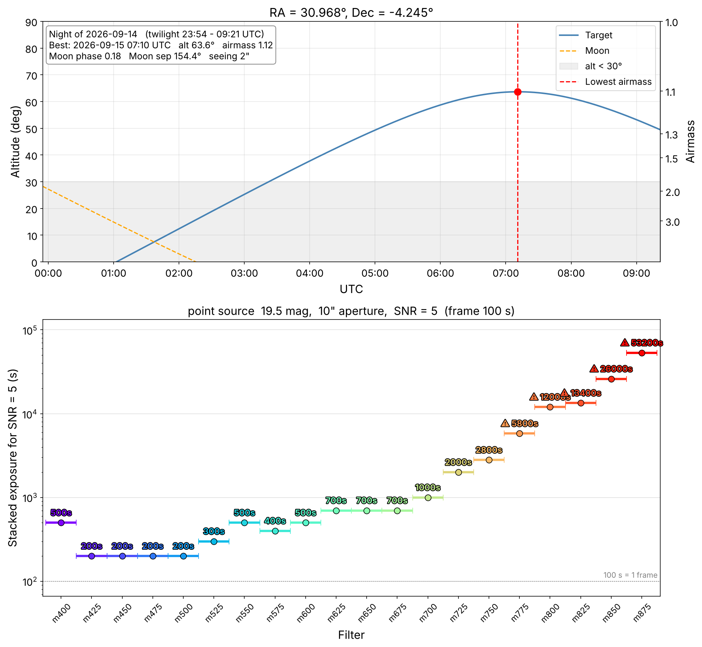

# 7dt_etc — 7DT Exposure Time Calculator

Exposure time calculator for the **7-Dimensional Telescope (7DT)** built on an empirical
noise model of archived 7DT frames. Supports **point sources** and **extended sources
(surface brightness)**, short and long exposures, and multi-frame observations.

Developed by **GWUniverse @ Seoul National University**.

> **v1.0.0** — first public release. See [CHANGELOG](CHANGELOG.md).

---

## Installation

```bash
git clone https://github.com/AstroWanni/7dt_etc.git
cd 7dt_etc
pip install -e .
```

Requirements: `numpy`, `astropy`, `astroplan`, `matplotlib`

---

## Quick Start

```python
from sevendt_etc import observe_and_etc

# Point source: exposure time to reach SNR = 5 for a 19.5 mag source
res, info = observe_and_etc(ra=30.968, dec=-4.245, date='2026-09-14', value=19.5, snr=5)

# Extended source: 24.0 mag/arcsec^2 measured over 100 arcsec^2
res, info = observe_and_etc(ra=30.968, dec=-4.245, date='2026-09-14', value=24.0, snr=5,
                            mode='extended', area=100)
```

`observe_and_etc` finds the best time of the night for the target (lowest airmass), computes the
observing conditions at that time, and returns the exposure time needed in each filter.

---

## Output of `observe_and_etc`

### Figure



**Top — target visibility on the given night**

| Element | Meaning |
|---|---|
| Blue line | Target altitude between astronomical evening and morning twilight |
| Orange dashed line | Moon altitude |
| Gray band | Altitude below `min_alt` (default 30°) |
| Red dashed line / dot | Best time = lowest airmass (highest altitude) of the night |
| Right axis | Airmass |
| Text box | Night date, twilight times, best time with altitude and airmass, Moon phase, Moon separation, seeing |

**Bottom — exposure time per filter at the best time**

| Element | Meaning |
|---|---|
| Points | Stacked exposure `T_stack` = N_frame × 100 s needed to reach the requested SNR (m400–m875, 25 nm steps) |
| Horizontal bar | Filter bandwidth (25 nm) |
| Label above point | `T_stack`; ⚠ marks times longer than `warn_threshold` (default 1 h) |
| Dotted line | One frame (100 s) |
| Title | Source type, brightness, aperture (point) or area (extended), SNR |

### Text output

```text
==============================================================================
7DT Exposure Time Calculator (sevendt_etc 1.0.0)
==============================================================================
[Detector]
Setting        : GAIN 2750, 1x1 binning, pixel scale = 0.505 "/pix
Gain           : 0.256 e-/ADU
Read noise     : 1.50 e-/pix (per frame)
Dark current   : 0.0005 e-/s/pix
Frame          : 100 s per frame (N_frame = number of frames)

[Source]
Source         : point source, 19.5 mag (AB), target SNR = 5
Measurement    : aperture diameter = 10", enclosed pixels = 308.0

[Conditions]
Target         : RA = 30.9680, Dec = -4.2450 deg
Obsdate        : 2026-09-15 07:10:50 UTC
Moon           : phase = 0.18, separation = 154.4 deg
Airmass        : 1.12
Seeing         : 2.00 arcsec

[Observation plan]
Night          : 2026-09-14 (local)
Twilight       : 2026-09-14 23:54 -> 2026-09-15 09:21 UTC (astronomical)
Above 30 deg   : 2026-09-15 03:23 -> 2026-09-15 09:21 UTC (6.0 h)
Recommended    : 2026-09-15 07:10:50 UTC (lowest airmass), alt = 63.6 deg

[Exposure time per band]  (skysig: per pixel, one 100 s frame)
  T_single : one exposure;  T_stack = N_frame x 100 s frames (SNR = sqrt(N_frame) x one-frame SNR)
filter       sky        sky  skysig  skysig   T_single    T_stack  N_frame
       [mag/as2] [e-/s/pix]    [e-]   [ADU]        [s]        [s]  [100 s]
m400       23.54     0.0045    1.66    6.48      239.4      500.0        5
m425       22.78     0.0169    2.00    7.80      152.7      200.0        2
m450       22.47     0.0266    2.23    8.70      142.1      200.0        2
m475       22.34     0.0318    2.34    9.15      141.2      200.0        2
m500       22.09     0.0430    2.57   10.04      147.8      200.0        2
m525       21.82     0.0524    2.75   10.73      181.2      300.0        3
m550       21.01     0.0989    3.49   13.64      350.4      500.0        5
m575       21.32     0.0751    3.13   12.24      277.6      400.0        4
m600       20.97     0.0998    3.50   13.69      370.6      500.0        5
m625       20.69     0.1029    3.55   13.86      590.5      700.0        7
m650       21.20     0.0514    2.73   10.66      495.4      700.0        7
m675       21.68     0.0269    2.23    8.73      438.0      700.0        7
m700       21.20     0.0391    2.49    9.73      648.7     1000.0       10
m725       20.64     0.0478    2.66   10.39     1398.0     2000.0       20
m750       20.74     0.0326    2.36    9.21     1714.1     2800.0       28
m775       20.10     0.0439    2.59   10.11     3914.8     5800.0       58  !
m800       19.35     0.0725    3.09   12.07     9225.1    12000.0      120  !
m825       20.01     0.0275    2.25    8.77     7546.3    13400.0      134  !
m850       19.47     0.0343    2.39    9.35    15885.6    26000.0      260  !
m875       18.85     0.0470    2.64   10.33    36207.6    53200.0      532  !
! : T_stack longer than 3600 s
==============================================================================
```

| Section | Meaning |
|---|---|
| Detector | GAIN 2750 / 1×1 setting, gain, read noise, dark current (common to every band), frame time |
| Source | Source type, brightness, target SNR, aperture (point) or measurement area (extended) |
| Conditions | Target, time, Moon phase / separation, airmass, seeing used for the calculation |
| Observation plan | Astronomical twilight, window above `min_alt`, recommended time (lowest airmass) |
| `sky` | Sky surface brightness [mag/arcsec²] and sky rate [e⁻/s/pix] predicted for the conditions |
| `skysig` | Background RMS per pixel in one 100 s frame (sky + dark + read noise) [e⁻] and [ADU] |
| `T_single` | Exposure time to reach the requested SNR in a single exposure [s] |
| `T_stack` | Total time when stacking 100 s frames, `N_frame` × 100 s [s] |
| `N_frame` | Number of 100 s frames to stack (SNR = √N_frame × one-frame SNR) |
| `!` | Longer than `warn_threshold` |

### Return values

```python
res, info = observe_and_etc(...)
res['m500']['exptime']   # total exposure time [s]
res['m500']['n_frame']   # number of 100 s frames to stack
res['m500']['exptime_single']   # single-exposure time [s];  res['m500']['exptime'] = n_frame x 100 s
res['m500']['mu_sky'], res['m500']['skysig_e']
info['report']           # text report (also saved with report_path='...')
info['best_time_utc'], info['airmass'], info['window_utc']
```

---

## Other functions

```python
from sevendt_etc import ExposureCalculator

calc = ExposureCalculator()              # 10" aperture model (default); ExposureCalculator(aperture=5) for 5"
cond = dict(ra=30.968, dec=-4.245, obsdate='2026-09-15T07:10:00', seeing=2.0)

calc.calculate_snr('all', 19.5, exptime=300, **cond)                               # SNR for a given exposure
calc.calculate_exptime('all', 19.5, snr=10, **cond)                                # exposure for a given SNR
calc.calculate_limit('all', exptime=300, snr=5, **cond)                            # limiting magnitude
calc.calculate_limit('all', exptime=300, snr=3, mode='extended', area=100, **cond) # limiting surface brightness

calc.plot_snr_vs_exptime('all', 19.5, **cond)   # line: single 1-1000 s; points: 100 s frames stacked (100-10000 s)
calc.plot_exptime_vs_snr('all', 19.5, **cond)
calc.plot_limit_vs_exptime('all', snr=3, mode='extended', area=100, **cond)   # single exposure, 1-1000 s
calc.plot_noise_budget('m400', 24.0, mode='extended', area=100, **cond)        # single exposure, 1-1000 s
```

### Inputs

| Argument | Description |
|---|---|
| `filter` | Filter name, list, or `'all'` (g, r, i, m400–m875 in 25 nm steps) |
| `value` | AB magnitude (`mode='point'`) or surface brightness in mag/arcsec² (`mode='extended'`) |
| `exptime` | Total exposure time [s]; taken as N = ceil(T / 100 s) frames |
| `snr` | Target signal-to-noise ratio |
| `mode` | `'point'` (default) or `'extended'` |
| `area` | Measurement area for extended sources [arcsec²] |
| `ra`, `dec`, `obsdate` | Target and time; Moon phase, Moon separation and airmass are computed from them |
| `moon_phase`, `moon_separation`, `airmass` | Set conditions directly instead of `ra`/`dec`/`obsdate` |
| `seeing` | Seeing FWHM [arcsec] (default 2.0) |

---

## Model

For each filter, the 5σ limiting magnitude of a 100 s frame is predicted from observing conditions:

```
UL5 = b0 + b1·moon_phase + b2·moon_sep + b3·airmass + b4·seeing
```

UL5 is converted into the per-pixel background (sky + dark), and the SNR is computed with the
read noise counted once per frame:

```
SNR = S·T / sqrt( S·T + Npix · (B·T + N·RN²) )
```

| Symbol | Point source | Extended source |
|---|---|---|
| S [e⁻/s] | 10^(−0.4 (m − ZP)) | 10^(−0.4 (μ − ZP)) · A |
| Npix | pixels in the 10″ (or 5″) aperture | A / pixscale² |

`B` sky + dark rate per pixel, `T` total exposure, `N` number of frames, `RN` = 1.50 e⁻,
dark = 0.0005 e⁻/s/pix, pixscale = 0.505″/pix.

Read noise makes short exposures less efficient than the √t scaling of the previous version,
and the SNR of bright sources now includes the source photon noise.

---

## Scope and limitations

- **Camera setting**: gain 2750 (high gain), 1×1 binning only.
- **Training data**: 2024–2026 100 s frames. Predictions are most reliable for typical conditions
  (airmass 1.2–1.7, average Moon). Very bright Moon and airmass > 1.7 are less accurate.
- **Filters**: `'all'` returns g, r, i and m400–m875 (25 nm steps). Filters with few frames or a different
  bandwidth (z, m438, m483, m512, m534, m561, m586, m615, m640, m661, m769w, m832w) are kept in the model
  files but excluded by default; request them by name to use them (a warning is printed).
- **Extended sources over large areas**: pixel noise is assumed independent, so limits over very large areas
  are optimistic (flat-field and background residuals are not included).
